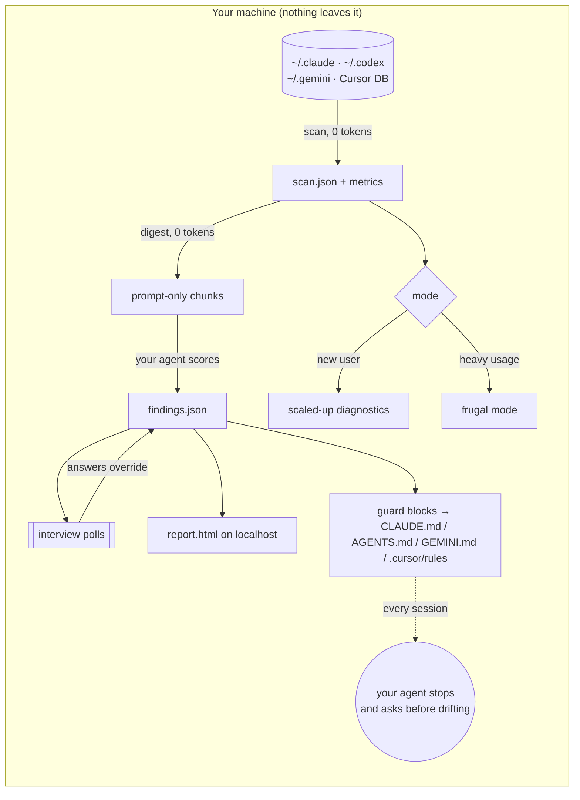

<div align="center">


# driftguard

**Your AI coding agent will build anything you ask. driftguard asks whether you should.**

Audits your Claude Code · Codex · Antigravity · Cursor history, interviews you, hosts an interactive report on localhost, and writes **drift guards** into your agent's rules, so the next session catches you before a bug fix turns into a new app.

[](https://github.com/stelies/driftguard/actions/workflows/ci.yml)
[](https://pypi.org/project/driftguard-cli/)
[](#install)
[](https://github.com/stelies/driftguard/blob/main/pyproject.toml)
[](#privacy)
[](https://github.com/stelies/driftguard/blob/main/LICENSE)

[**Live demo →**](https://stelies.github.io/driftguard/demo/) · [Website](https://stelies.github.io/driftguard) · [Install](#install) · [How it works](#how-it-works) · [Token crisis mode](#token-crisis-mode)


</div>

---

## Why

Vibe coding makes starting things free. The cost shows up later: seven half-built side projects, a usage limit hit every week, and prompts that slid from *"fix these 3 bugs"* to *"uhhh make it 3D or whatever"*.

Typical patterns driftguard surfaces from your own history:

- a burst month where most sessions went into projects you never use
- focus breaking right after the first answer: the second prompt is a new topic, a long absence, or frustration
- vague delegation ("do whatever you want") right before the sessions you rage at

Analytics tools show you numbers. driftguard turns them into **rules your agent follows every session**.

## What you get

| | |
|---|---|
| **Drift guard** | A managed block in your global agent rules: who you are, a **project registry** (active / stalled / parked / dead), and protocols your agent follows: **stop and poll** when you drift, a **new-project gate** ("who uses it? does a tool already exist? which active project pauses?"), and a **frustration protocol**. |
| **Purpose blocks** | Every project's `CLAUDE.md` / `AGENTS.md` / `GEMINI.md` / `.cursor/rules` gets its purpose, done-condition and the drift traps you actually fell into, with dates. |
| **Interview** | Your agent polls you (goals, plan, tone, "is this verdict fair?"). **Your answers override the AI.** |
| **Interactive report** | Motivation timeline, prompt-quality coaching with rewrites of *your* worst prompts, a **brain-disconnect map**, token spend, project kill/keep board, drift graph, 3D views. One HTML file, opens offline. |
| **Token crisis mode** | Detects heavy usage and switches to frugal mode; `driftguard handoff` writes a ≤40-line HANDOFF.md so you can restart cheap. |
| **Pulse** | `driftguard pulse` (opt-in SessionStart hook) checks new sessions for **zero tokens** and speaks up only when something needs attention. |

<p align="center"><br><sub>3D "brain terrain": prompts per hour × weekday; red = where you disconnect. Drag to rotate in the <a href="https://stelies.github.io/driftguard/demo/">live demo</a>.</sub></p>

## Install

```bash
pipx install driftguard-cli        # or: uv tool install driftguard-cli   ·   pip install --user driftguard-cli
```

One-liners that also install the agent integrations they find:

```bash
curl -fsSL https://raw.githubusercontent.com/stelies/driftguard/main/scripts/install.sh | sh       # macOS / Linux / WSL
```
```powershell
irm https://raw.githubusercontent.com/stelies/driftguard/main/scripts/install.ps1 | iex           # Windows
```

Windows is native: no WSL, no Node, no admin rights. PowerShell or cmd, with Python 3.9+ (`winget install Python.Python.3.13`). It reads Claude Code from `%USERPROFILE%\.claude`, and the `driftguard pulse` hook works there unchanged.

<details>
<summary><b>Claude Code</b>: plugin or skill</summary>

```text
/plugin marketplace add stelies/driftguard
/plugin install driftguard@driftguard
```
Then run `/driftguard`. Manual: copy `integrations/claude/skills/driftguard/` to `~/.claude/skills/`.
Optional zero-token pulse, in `~/.claude/settings.json` (see [`hooks-example.json`](https://github.com/stelies/driftguard/blob/main/integrations/claude/hooks-example.json)):
```json
{ "hooks": { "SessionStart": [ { "hooks": [ { "type": "command", "command": "driftguard pulse" } ] } ] } }
```
</details>

<details>
<summary><b>Codex CLI</b></summary>

Copy `integrations/codex/skills/driftguard/` to `~/.codex/skills/` and add [`AGENTS.snippet.md`](https://github.com/stelies/driftguard/blob/main/integrations/codex/AGENTS.snippet.md) to `~/.codex/AGENTS.md`. Ask Codex: *"run driftguard"*. Guards go to `AGENTS.md`.
</details>

<details>
<summary><b>Antigravity</b></summary>

Copy [`driftguard.md`](https://github.com/stelies/driftguard/blob/main/integrations/antigravity/workflows/driftguard.md) to `~/.gemini/antigravity/global_workflows/` and run `/driftguard` in the agent panel. Guards go to `~/.gemini/GEMINI.md` (Antigravity's global rules) and each project's `GEMINI.md`. Still on the old Gemini CLI? Use [`driftguard.toml`](https://github.com/stelies/driftguard/blob/main/integrations/antigravity/commands/driftguard.toml) in `~/.gemini/commands/`.

History: driftguard reads the plain-text chat logs under `~/.gemini/`. Antigravity's IDE conversations are stored as binary `.pb` files and are **not** parsed yet, so the report may show fewer Antigravity sessions than you actually had.
</details>

<details>
<summary><b>Cursor</b></summary>

Copy [`driftguard.mdc`](https://github.com/stelies/driftguard/blob/main/integrations/cursor/driftguard.mdc) to `.cursor/rules/` and ask the agent to run driftguard. Guards go to `.cursor/rules/driftguard.mdc`; Cursor has no global rules file, so paste the global block into *Settings → Rules*.
</details>

## Use

```bash
driftguard scan                 # read every agent's history (incremental, ~0.5 s warm)
driftguard report --serve       # metrics-only report on localhost, no LLM needed
/driftguard                     # in your agent: scoring + interview + verdicts + guards
```

| Command | What it does | LLM tokens |
|---|---|---|
| `scan [--json]` | Parse histories → `~/.driftguard/scan.json`, choose the mode | 0 |
| `digest` | Prompt-only chunks for the scoring pass (often 100× smaller than transcripts) | 0 |
| `ingest findings.json --answers answers.json` | Merge agent verdicts + your answers (answers win) | 0 |
| `report [--serve] [--lan]` | Single-file interactive report; serves on the first free port ≥ 5191 | 0 |
| `guard [--apply]` | Diff (default) or write the guard blocks, with `.bak` backups | 0 |
| `handoff` | ≤40-line HANDOFF.md from your latest session | 0 |
| `pulse` | Silent unless: new project, reopened parked project, token spike, 20+ new sessions | 0 |
| `budget` | Token burn per 5-hour block + advice | 0 |

## How it works



**Two layers.** A deterministic, dependency-free Python CLI does all reading and math. Your agent does only the judgment (scoring prompt digests, interviewing you, wording the guards). Raw transcripts never enter the model's context.

**It adapts to you:**
- **New user** (fewer than ~15 sessions, under 3 weeks, or no rules/skills/hooks yet): every metric is explained, *Setup health* comes first, starter rewrites use your own prompts, and you get fewer verdicts.
- **Heavy usage** (limit talk in prompts, spend concentrated in a few sessions, recent 5h blocks above your p90): Haiku/Sonnet subagents, at most 2 at once, smaller digests, an optional scoring pass, and token-saver rules added to your guard.

### The disconnect heuristics

| Signal | Rule |
|---|---|
| **away** | ≥ 40 min since your previous prompt in the same session |
| **topic switch** | ≥ 8 content words, < 4% word overlap with your last 3 prompts, not a slash command |
| **frustration** | rage words + caps, `??`, or dense shouting (pasted logs excluded) |

They're heuristics, and the report says so. The interview exists because only you know whether a project was a waste.

## Token crisis mode

If you're about to hit your limit:

```bash
driftguard budget          # where the tokens went, per 5-hour block
driftguard handoff         # ≤40-line HANDOFF.md: goal, files touched, open todos, last asks, next step
```
Then start a fresh session: *"read HANDOFF.md and continue"*. Your guard also gains rules such as cheap subagents ≤2, digests instead of transcripts, never re-reading files, and compacting at boundaries.

## Privacy

- Everything runs locally. The CLI makes **no network calls**.
- The scoring pass runs inside **your own agent session**, under your plan, like any other prompt.
- Transcript text is treated as data: the skill tells your agent never to follow instructions found inside old messages.
- `guard` is a dry run until you pass `--apply`, and every changed file gets a `.bak`.
- The [live demo](https://stelies.github.io/driftguard/demo/) uses a **synthetic** dataset.

## driftguard vs. the rest (use them together)

| | driftguard | `/insights` (built-in) | [ccusage](https://github.com/ryoppippi/ccusage) | [sniffly](https://github.com/chiphuyen/sniffly) |
|---|:-:|:-:|:-:|:-:|
| Token & cost accounting | ✓ (5h blocks, per project) | – | **✓✓** | ✓ |
| Friction / usage report | ✓ | **✓✓** | – | ✓ |
| Cross-project drift & side-project verdicts | **✓** | – | – | – |
| Interview that overrides the AI | **✓** | – | – | – |
| Writes persistent guards into agent rules | **✓** | suggestions | – | – |
| New-project gate + project registry | **✓** | – | – | – |
| Codex · Antigravity · Cursor | ✓ | – | partial | – |
| Zero dependencies, offline single-file report | ✓ | ✓ | – | – |

If you only want token numbers, use ccusage. If you want the agent to **stop you from starting project #8**, use driftguard.

## FAQ

<details><summary><b>Does it cost tokens?</b></summary>
The CLI costs zero. The optional scoring pass reads compact prompt-only digests, typically hundreds of times smaller than the raw transcripts (a few hundred sessions come to roughly 100k tokens, split into chunks). In frugal mode it shrinks further, or you can skip it and keep a metrics-only report.
</details>
<details><summary><b>Will it rewrite my CLAUDE.md?</b></summary>
Only between its own markers (<code>&lt;!-- driftguard:global v1 --&gt;</code> … <code>&lt;!-- /driftguard:global --&gt;</code>), only with <code>--apply</code>, and with a <code>.bak</code> backup. Everything outside the markers is untouched.
</details>
<details><summary><b>Windows? WSL?</b></summary>
Both. On native Windows it runs from PowerShell or cmd: paths resolve via <code>%USERPROFILE%</code> / <code>%APPDATA%</code> (and <code>CLAUDE_CONFIG_DIR</code> if set), output is UTF-8 even through legacy code-page pipes, and the report opens in your default browser. If <code>driftguard</code> is not found right after installing, reopen the terminal or use <code>py -m driftguard</code>. On WSL it also reads the Windows-side histories under <code>/mnt/c/Users/*</code>. CI runs the tests on Windows (including a PowerShell-only smoke test), macOS and Linux.
</details>
<details><summary><b>Codex / Antigravity / Cursor formats change. Will it break?</b></summary>
Adapters are defensive (unknown events are skipped) and covered by fixture tests. Codex <code>.jsonl.zst</code> needs <code>pip install driftguard-cli[zstd]</code>.
</details>

## Contributing

```bash
git clone https://github.com/stelies/driftguard && cd driftguard
python -m pip install -e ".[dev]" && python -m pytest -q
cd web && npm ci && npm run build      # rebuilds driftguard/report/template.html
python scripts/make_demo_data.py --out /tmp/demo.html
```
Adapter fixes with a fixture are especially welcome. Report UI: SvelteKit + Tailwind with components from [llama.cpp's web UI](https://github.com/ggml-org/llama.cpp) (MIT).

## License

MIT © stelies
